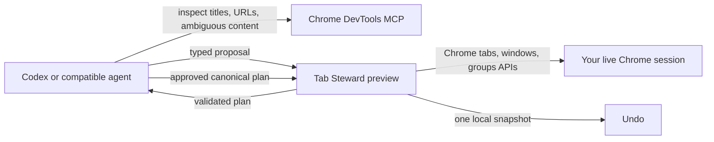

# Organise Chrome Tabs

Safely turn a crowded Chrome session into a small set of topic-based windows.

This project combines **Tab Steward**, a local Manifest V3 extension, with a
reusable agent skill and Chrome DevTools MCP. The agent can understand what
similarly named tabs are actually about; the extension owns every tab and
window mutation, validates the plan, and keeps an undo snapshot.

## Why this exists

Browser automation tools can inspect pages but cannot reliably manage Chrome's
native windows and tab groups. Chrome extensions can manage those objects but
usually know only titles and URLs. Organise Chrome Tabs joins the two through a
small, reviewable API:



## Features

- Inventories all normal Chrome windows, tabs, pinned tabs, and native groups.
- Distinguishes tabs from the same site by subject, including different YouTube
  topics.
- Reuses coherent existing windows or creates new topic windows.
- Previews an agent-authored plan before any browser mutation.
- Defaults to window-only organisation and removes existing native groups in
  the same undoable operation.
- Protects pinned tabs and the extension dashboard.
- Detects exact duplicate URLs; closing remains opt-in.
- Creates, labels, focuses, and closes Chrome windows.
- Stores one local pre-change snapshot for undo.
- Works without an agent using a local, deterministic title/URL classifier.

## Requirements

- Google Chrome 144 or newer for Chrome DevTools MCP auto-connect.
- Node.js 20 or newer.
- Codex CLI, or another MCP-capable agent that supports agent skills.

## Install

### 1. Clone and load the extension

```bash
git clone https://github.com/ShreeramBhat/Organise-Chrome-Tabs.git
cd Organise-Chrome-Tabs
```

Open `chrome://extensions`, enable **Developer mode**, choose **Load unpacked**,
and select:

```text
plugins/organise-chrome-tabs/extension
```

Click **Tab Steward** in Chrome's extension menu to open its dashboard.

### 2. Allow DevTools to connect to your current Chrome

Open `chrome://inspect/#remote-debugging` and enable remote debugging for the
current browser profile. Chrome displays a confirmation whenever a client
connects.

The bundled MCP configuration uses:

```text
npx -y chrome-devtools-mcp@latest --autoConnect --no-usage-statistics
```

Chrome DevTools MCP can inspect everything exposed by the connected browser.
Review the upstream
[security notice](https://github.com/ChromeDevTools/chrome-devtools-mcp#disclaimers)
and avoid exposing sensitive profiles to agents you do not trust.

### 3. Install the Codex plugin

From the cloned repository:

```bash
codex plugin marketplace add .
codex plugin add organise-chrome-tabs@organise-chrome-tabs
```

Or add the public GitHub marketplace directly:

```bash
codex plugin marketplace add ShreeramBhat/Organise-Chrome-Tabs
codex plugin add organise-chrome-tabs@organise-chrome-tabs
```

Start a new Codex session after installation. Confirm the plugin and browser
tools with `/plugins` and `/mcp`.

If you only want the standalone skill, copy or symlink
`plugins/organise-chrome-tabs/skills/organize-chrome-tabs` into
`~/.agents/skills/`.

## Use

Invoke the skill explicitly:

```text
$organize-chrome-tabs Organize my Chrome tabs into topic-based windows. Do not close anything.
```

Other useful prompts:

```text
$organize-chrome-tabs Describe all my open tabs without changing anything.

$organize-chrome-tabs Consolidate my Chrome windows, preserve pinned tabs, and leave uncertain tabs where they are.

$organize-chrome-tabs Find exact duplicate tabs and show me which ones you would close, but do not close them yet.
```

The agent reads the inventory, inspects only ambiguous pages, previews a typed
plan, applies authorized moves, and verifies the resulting tab IDs and window
layout. Closing tabs or windows always requires explicit approval.

## Use the dashboard without an agent

1. Open Tab Steward from Chrome's extension menu.
2. Choose a window strategy and select **Analyse tabs**.
3. Review every proposed destination.
4. Leave duplicate closing disabled unless you have checked each candidate.
5. Select **Apply plan**.

Local analysis reads only tab titles and URLs. It never injects scripts into
web pages and does not send browser data over the network.

## Automation API

Messages are accepted only from the extension dashboard context.

```js
const inventory = await chrome.runtime.sendMessage({
  type: "GET_INVENTORY",
});

const preview = await chrome.runtime.sendMessage({
  type: "PREVIEW_AGENT_PLAN",
  proposal: {
    version: 1,
    removeExistingGroups: true,
    assignments: [
      {
        tabId: 123,
        destination: { newWindow: "Research" },
      },
    ],
  },
});

const applied = await chrome.runtime.sendMessage({
  type: "APPLY_PLAN",
  plan: preview.result.plan,
});
```

Tabs omitted from `assignments` stay in their current windows. A destination is
either `{windowId: 42}` or `{newWindow: "Research"}`. Assignments may also
contain `groupTitle`, `groupColor`, and `close`; pinned tabs cannot move or join
groups.

See
[`tab-steward-api.md`](plugins/organise-chrome-tabs/skills/organize-chrome-tabs/references/tab-steward-api.md)
for the complete message table and recovery semantics.

## Safety model

- **Preview first:** `PREVIEW_AGENT_PLAN` validates a proposal without changing
  Chrome.
- **Single mutation boundary:** only Tab Steward calls Chrome's tab, group, and
  window APIs.
- **No host permissions:** the extension cannot read page bodies.
- **Pinned-tab protection:** pinned tabs remain in their current windows.
- **Explicit deletion:** duplicate detection never closes tabs by default.
- **Undo:** the most recent apply, window close, or ungroup operation stores one
  snapshot.

Undo can reopen closed URLs, but cannot recover navigation history, unsaved
forms, or in-page state. Applying a later mutation replaces the previous undo
snapshot.

Agent-assisted mode is not purely local: page information inspected through
Chrome DevTools is handled according to the model provider and agent you use.
The extension itself remains local and has no analytics or network code.

## Development

```bash
npm test
npm run check
npm run test:ui
```

The test suite covers classification, planning, external proposal validation,
window swaps, ungrouping, undo behavior, manifest permissions, and a headless
dashboard smoke test.

After changing extension code, reload Tab Steward from `chrome://extensions`.

Contributions are welcome. See [CONTRIBUTING.md](CONTRIBUTING.md) and
[SECURITY.md](SECURITY.md).

## License

[MIT](LICENSE)
